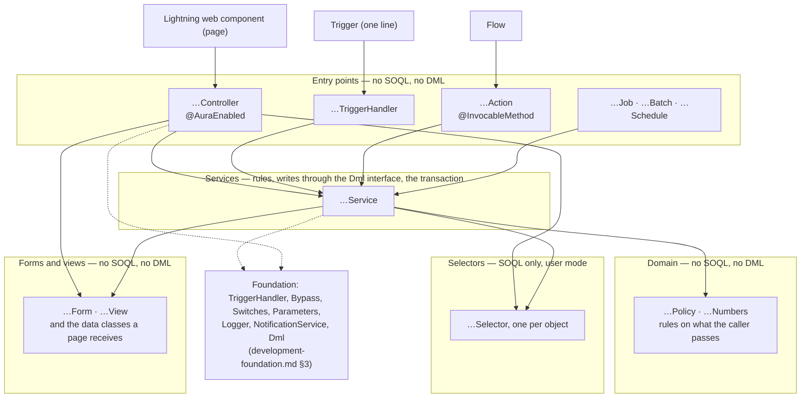

# Architecture — how Apex and components are layered, and the libraries we test with

**Internal · delivery team · Agentforce Distributor**
**Status:** template from the delivery kit; the team adopts or adjusts it with `development-foundation.md`. The
conventions are in `development-foundation.md` §2.4, §2.5 and §2.7; the review rules that check them are in
`code-review-rules.md` (APX-12, APX-34 to APX-39, APX-41, TST-03, TST-14, TST-15, LWC-01, LWC-05, LWC-06, LWC-12,
LWC-13). This page explains them and shows how to use the libraries; it adds no rule of its own.
**Sources:** the libraries' own repositories, read at the releases named in §3; Salesforce documentation on
[composing components](https://developer.salesforce.com/docs/platform/lwc/guide/create-components-compose.html),
[sharing JavaScript code](https://developer.salesforce.com/docs/platform/lwc/guide/js-share-code.html),
[data in components](https://developer.salesforce.com/docs/platform/lwc/guide/data-guidelines.html) and
[Jest tests](https://developer.salesforce.com/docs/platform/lwc/guide/unit-testing-using-jest-create-tests.html);
Trailhead, [Separation of Concerns](https://trailhead.salesforce.com/content/learn/modules/apex_patterns_sl/apex_patterns_sl_soc).

---

## 0 · The answer

- **Apex in four layers**, each calling only the ones below it: entry points, services, selectors, and the forms
  and views that turn records into what a page shows — plus **domain classes**, the rules that need no database,
  which a service calls. No framework.
- **Lightning web components of three kinds**: a page, the parts it is built from, and modules of shared code.
- **Three libraries, all for tests**: apex-mockery replaces a class in an Apex test, SObject Fabricator builds
  records in memory, `@salesforce/sfdx-lwc-jest` runs Jest for components. They sit in `force-app/distributor/vendor/` and
  in `package.json`, as their authors published them. Beside them, `jest-junit` writes Jest's results for the
  pipeline's test summary.
- **Access is never mocked.** What a user may read or change is tested on inserted records, run as that user
  (`development-foundation.md` §2.4).

---

## 1 · Apex — four layers



| Layer | Classes | Does | Does not |
|---|---|---|---|
| Entry point | `Controller`, `TriggerHandler`, `Action`, `Job`, `Batch`, `Schedule`; an agent's actions and a prompt template's grounding are `Action`s (`agentforce.md`) | Receives the call, checks what it was given, reads through a selector, changes records through a service, turns an exception into a message the user understands | Query or write records itself |
| Service | `Service` | The rules of one use case: decides, changes records through `DstDml`, owns the transaction; takes and returns collections | Know which screen or trigger called it |
| Selector | `Selector`, one per object | Every query on its object, in user mode unless a method says otherwise and why (SEC-03, SEC-04) | Write records; decide anything |
| Form, view | `Form`, `View` | Turns records into the data a page receives, and what a page sends back into records; the data classes live here | Query or write records |
| Domain | Named for what it decides: `InvoicePolicy`, `InvoiceNumbers` | A rule that needs no database: a policy, a calculation, the normalising of what a user typed; static methods on what the caller passes, parameter values included (APX-43) | Query or write records; read `DstParameters`; call anything but other domain classes |

**Why these four.** Left to itself, a build grows one controller per page that queries, decides and maps at once;
splitting the largest of them always finds the same four roles — something saves, something reads, something maps
records to and from the page. This page names those roles so every new class takes one of them. The Trailhead
module on separation of concerns rates layering as *worth considering* for a team of one to six developers with
changing requirements — the usual size of a delivery team — and the four layers are the part of it that pays
without a framework (§6).

**Why a domain beside the service.** A service that holds its rules is tested by replacing its selectors and
its write (§4.2). A rule that needs neither — a return window, a quantity check, an invoice number as a customer
types it — is clearer as a static method that takes values and returns a decision: its test is a list of
`Assert` calls on values, with no records, no users and no mocks, and two services can share it. This is not the
Domain of fflib (§6): no instance per set of records, no trigger logic. **Default — adjust per project.** A project
that keeps every rule inside its services drops the layer and APX-43.

**How the layers talk**

- **Calls go down.** No class uses a controller or its inner classes, except the controller's own test and a
  feature's `Dst<Feature>Steps`, which runs the entry points for its feature class (§4.6); a service
  never calls an entry point. A domain class calls only other domain classes; the service reads what a rule needs
  — records, a parameter's value — and passes it in. A data class a page receives lives in the form or view that builds it, not inside
  the controller (APX-35, APX-36).
- **Reads may skip the service.** A controller that only shows data calls the selector and the view; anything that
  changes a record goes through a service.
- **System mode** follows `development-foundation.md` §2.3: a read or write the user's own access refuses names
  system mode on the statement, with a comment saying why (SEC-03, SEC-04). A write names its
  `DstDmlMode` — `SYSTEM_WITHOUT_SHARING` when sharing has to be bypassed as well — and
  `DstDatabaseDml` runs it with that sharing (§4.1). Only a read that has to bypass sharing moves into
  a small class, or an inner class, `without sharing`, named for what it does, with the comment SEC-02 asks for —
  `DstCustomerSearch`, say.
- **Triggers** are one line; the handler calls services in a fixed order (`development-foundation.md` §3 F-1).
  Where our logic must run from a trigger the client owns, that trigger calls our services directly, and the design
  says so.
- **The foundation** (`Dst*`, `development-foundation.md` §3) is used from any layer, with the small
  helpers F-5 builds a message with, which are static and read setup data only.

**A sketch** — the names are illustrative, on a sample object `Invoice__c`. A controller reads one invoice through
the selector and hands the record to a view.

```apex
/** Reads Invoice__c for every feature. */
public inherited sharing class InvoiceSelector {
    public List<Invoice__c> byIds(Set<Id> invoiceIds) {
        return [
            SELECT Id, Customer_Name__c, Approver__r.Name, CreatedDate
            FROM Invoice__c
            WHERE Id IN :invoiceIds
            WITH USER_MODE
        ];
    }
}

/** What the invoice summary shows: built from the record it is given; it reads and writes nothing. */
public inherited sharing class DstInvoiceSummaryView {
    public class Summary {
        @AuraEnabled
        public String customer;
        @AuraEnabled
        public String approver;
        @AuraEnabled
        public Date issuedOn;
    }

    public static Summary of(Invoice__c invoice) {
        Summary s = new Summary();
        s.customer = invoice.Customer_Name__c;
        s.approver = invoice.Approver__r?.Name;
        s.issuedOn = invoice.CreatedDate?.date();
        return s;
    }
}

/** Data for the invoice summary page. */
public with sharing class DstInvoiceSummaryController {
    @TestVisible
    private static InvoiceSelector invoices = new InvoiceSelector();

    @AuraEnabled(cacheable=true)
    public static DstInvoiceSummaryView.Summary getSummary(Id invoiceId) {
        List<Invoice__c> rows = invoices.byIds(new Set<Id>{ invoiceId });
        if (rows.isEmpty()) {
            throw new AuraHandledException(System.Label.DST_Invoice_Not_Available);
        }
        return DstInvoiceSummaryView.of(rows[0]);
    }
}
```

The selector is an instance, held in a `@TestVisible private static` field: that is all a test needs to replace
it (§4.1). A static method could not be replaced, because the Stub API that apex-mockery builds on stubs instance
methods only.

---

## 2 · Lightning web components — three kinds

| Kind | Name | Exposed | Does | Does not |
|---|---|---|---|---|
| Page | `dst` + page: `dstSubmitInvoice` | Yes — in Lightning App Builder or Experience Builder | Calls Apex, holds the page's state, navigates through `c/dstPages`, shows toasts | — |
| Part | `dst` + what it is: `dstFormSteps` | No | Receives data through `@api` properties, reports what the user did through events | Call Apex, navigate |
| Module | `c/dst…`, no template | No | Shared JavaScript or CSS: `c/dstPages` (page references), `c/dstTheme` (colors, spacing, type), `c/dstErrors` (the message of an Apex error), `c/dstFormat` (number and date formatters). A module may call cacheable Apex for what it shares — a list view's Id by its developer name, for example | Render anything; hold a page's state |

This is the owner and child model of the LWC guide — the owner sets its children's public properties and listens
to their events — with one more constraint of ours: a part never talks to the server, so it can be tested in Jest
with nothing but its inputs. A component on an internal record page or behind a quick action is a page of its own
and is named for what it acts on (`invoiceChanges`), not with the prefix (`development-foundation.md` §2.2).

**Data.** Lightning Data Service first — base record components, then wire adapters. Apex when a page combines
objects, needs a system-mode read, or acts on several records at once. Apex data is not managed by LDS: after a
write the page calls `refreshApex`, and `notifyRecordUpdateAvailable` when LDS may hold the same records (LWC-08).

**Repeated code becomes a module or a part.** When a second page needs what a first one has — the message of an
Apex error with a fallback, number and date formatters, loading a static resource, a layout of totals and counts,
the numbered steps of a form — it moves into a module or a part when a story next touches it, never into a copy
(LWC-13).

---

## 3 · The libraries

Versions as current when the kit was created; a project pins the release it takes, records it here, and moves it
only by the upgrade of §5.

| Library | For | Release | License | Where, and what reaches the org |
|---|---|---|---|---|
| [apex-mockery](https://github.com/salesforce/apex-mockery) | Replacing a class in an Apex test and checking how it was called | 2.3.0 (tag `v2.3.0`) | BSD 3-Clause, © Salesforce.com, Inc. | `force-app/distributor/vendor/apex-mockery/`: `Mock`, `MethodSpy`, `Expect`, `Argument` — all four `@IsTest`, so they run only inside tests and need no coverage |
| [SObject Fabricator](https://github.com/mattaddy/SObjectFabricator) | Records in memory with any field set: formula, system, roll-up and relationship fields | No tagged release; `master` at commit `bdf66b2` | MIT, © the library's authors | `force-app/distributor/vendor/sobject-fabricator/`: the `sfab_*` classes, used only by tests, and their own tests, which `tools/deploy-build.sh` runs with ours |
| [@salesforce/sfdx-lwc-jest](https://www.npmjs.com/package/@salesforce/sfdx-lwc-jest) | Jest for Lightning web components: the LWC compiler, and stand-ins for the `lightning/*` and `@salesforce/*` modules | 7.9.0 | MIT | `package.json` (`devDependencies`), `jest.config.js`; nothing reaches the org |
| [jest-junit](https://www.npmjs.com/package/jest-junit) | Jest's results as JUnit XML, which the merge request's test summary reads | 17.0.0 | Apache-2.0 | `package.json` (`devDependencies`, and its settings under `jest-junit`); used by `npm run test:ci` in the pipeline; nothing reaches the org |

**Pinning.** Every library is pinned to one exact release: an Apex library by the tag or commit its files were
copied from, an npm package by an exact version in `package.json` — no range — with `package-lock.json` committed.
A new release is taken on purpose, in a merge request of its own, never by an install that happened to resolve to
it.

Both Apex libraries are open source with no fee and no registration. Each keeps its license beside its classes,
which is the one condition both licenses set. Neither comes with support from its authors: a defect is ours to work
around, in our own code, not by editing theirs (§5). Whether third-party code used only by tests needs the client's
agreement before it goes to their production org is asked once, before the first production release, and the
answer recorded in the decisions log.

---

## 4 · How to use them

### 4.1 Make a class replaceable

The class that uses a selector or another service holds it in a field a test can reach. Nothing else changes: no
interface, no factory, no registry.

```apex
public with sharing class DstInvoiceSummaryController {
    @TestVisible
    private static InvoiceSelector invoices = new InvoiceSelector();
    …
}
```

The replaced class needs a constructor the test can see and instance methods; the Stub API cannot replace a static
method (§1).

**The write is the one exception.** A class holds its writes the same way, but behind the interface
`DstDml`, whose implementation `DstDmlProvider` chooses (`development-foundation.md` §3
F-9): a `Database` call is static, and one shared fake answers every write as the database would, so a test does
not configure each one (§4.2). Every call names its mode, and a system mode says why at the call.

```apex
public without sharing class InvoiceReminderService {
    @TestVisible
    private static DstDml dml = DstDmlProvider.get();
    …
        // System mode without sharing: the reminder stamp is the job's own, and whoever scheduled the job
        // need neither reach nor edit the invoice.
        List<DstDmlResult> results = dml.updateEach(stamps, DstDmlMode.SYSTEM_WITHOUT_SHARING);
    …
}
```

### 4.2 Replace it with apex-mockery

`Mock.forType` creates the stand-in, `spyOn` names the method to drive, `returns` (or `throwsException`,
`whenCalledWith(…).thenReturn(…)`) says what it answers, and `Expect.that` checks how it was called. A method not
configured returns `null`. The test of the sketch in §1:

```apex
@IsTest
private class DstInvoiceSummaryControllerTest {
    @IsTest
    static void showsTheCustomerAndTheApproverOfTheInvoice() {
        Id invoiceId = Invoice__c.SObjectType.getDescribe().getKeyPrefix() + '000000000001';
        Invoice__c invoice = (Invoice__c) new sfab_FabricatedSObject(Invoice__c.class)
            .set('Id', invoiceId)
            .set('Customer_Name__c', 'Example LLC')
            .set('Approver__r.Name', 'Pat Approver')
            .toSObject();

        Mock invoicesMock = Mock.forType(InvoiceSelector.class);
        MethodSpy byIds = invoicesMock.spyOn('byIds');
        byIds.returns(new List<Invoice__c>{ invoice });
        DstInvoiceSummaryController.invoices = (InvoiceSelector) invoicesMock.stub;

        Test.startTest();
        DstInvoiceSummaryView.Summary summary = DstInvoiceSummaryController.getSummary(invoiceId);
        Test.stopTest();

        Expect.that(byIds).hasBeenCalledWith(new Set<Id>{ invoiceId });
        Assert.areEqual('Example LLC', summary.customer, 'The customer comes from the invoice');
        Assert.areEqual('Pat Approver', summary.approver, 'The approver comes from the invoice');
    }
}
```

- **End with `Assert`.** `pmd:ApexUnitTestClassShouldHaveAsserts` does not know `Expect.that`, so a test that
  checks only the calls is reported (TST-07); assert the result as well.
- **No `runAs` here.** The outcome does not depend on the running user — the selector is replaced — so the test
  needs none, and its Code Analyzer finding is suppressed with that reason (`development-foundation.md` §2.4
  *Who runs it*). What a user may see is the job of the tests of §4.4.
- **No DML on a fabricated record.** A record built in memory was never inserted; a service that writes is tested
  on records from `DstTestDataFactory`, or with its writes replaced by `DstDmlFake`.

**Replace the write with `DstDmlFake`.** Set the class's `dml` field to a fake, run the service, then
read what it wrote and in which mode. The fake gives inserted records Ids, so code that links a new record by its Id
runs as it would; a record the test names is refused, as a validation rule or the sharing would refuse it.

```apex
DstDmlFake fake = new DstDmlFake();
fake.refuse(lockedInvoiceId, StatusCode.UNABLE_TO_LOCK_ROW, 'unable to obtain exclusive access');
InvoiceReminderService.dml = fake;
…
Assert.areEqual(DstDmlMode.SYSTEM_WITHOUT_SHARING, fake.writes[0].mode, 'The stamp is the job\'s own');
Assert.areEqual(2, fake.recordsOf('updateEach').size(), 'Both due invoices are written, the refused one too');
```

The library's own recipes, one per feature, are in its repository under `force-app/recipes/` at the release of §3;
they are not copied here.

### 4.3 Build records in memory with SObject Fabricator

`new sfab_FabricatedSObject(<Type>.class)`, then `set` for fields — by name or by `SObjectField` — and
relationships, `add` for child records, and `toSObject()` at the end. Fields a test could not set on a new record —
`CreatedDate`, formulas, roll-ups, a parent's name — are set the same way.

```apex
Invoice__c invoice = (Invoice__c) new sfab_FabricatedSObject(Invoice__c.class)
    .set('Customer_Name__c', 'Example LLC')
    .set('CreatedDate', Datetime.newInstance(2026, 1, 1))
    .set('Approver__r.Name', 'Pat Approver')
    .toSObject();
```

Use it for the layers that only read what they are given — forms, views, the rules inside a service — where
inserting a record would mean passing every validation rule and flow of the org (`development-foundation.md` §3
F-6) for a test that never needed the database. A record the test **inserts** still comes from
`DstTestDataFactory` (TST-03).

### 4.4 What is not mocked

**Access.** A test of who may read or change a record — an external user reaching another account's record
(SEC-07), a user without the custom permission — inserts the records with `DstTestDataFactory` and runs
as that user (`development-foundation.md` §2.4 *Who runs it*; TST-15). A mocked selector returns whatever it is
told, whoever asks, so it cannot show what sharing and field access would have hidden.

**Triggers and flows.** Whether the org's own automation accepts a record is tested by inserting it; that is what
the factory's self-test does (F-6).

### 4.5 Jest for components

- Tests sit in a `__tests__` folder inside the component's folder and end in `.test.js`. `.forceignore` keeps them
  out of every deployment.
- `npm install` once, then `npm test`; `npm run test:coverage` adds a coverage report. `jest.config.js` limits Jest
  to `force-app/distributor`.
- Apex never runs in a Jest test: every `@salesforce/apex/…` import a component uses is replaced with
  `jest.mock(…, { virtual: true })`. A module that asks Apex for a list view's Id, tested this way:

```javascript
import { invoiceLists, invoiceListPage } from "c/dstPages";
import getListViewId from "@salesforce/apex/DstListViewController.getListViewId";

jest.mock("@salesforce/apex/DstListViewController.getListViewId", () => ({ default: jest.fn() }), {
    virtual: true
});

it("asks Apex for the Id of an invoice list view by its developer name, then links to it", async () => {
    getListViewId.mockResolvedValue("00B000000000002");

    const page = await invoiceListPage(invoiceLists.overdue);

    expect(getListViewId).toHaveBeenCalledWith({ objectApiName: "Invoice__c", developerName: "Overdue" });
    expect(page.state.filterName).toBe("00B000000000002");
});
```

- Test first what holds logic: modules, then parts, then the logic of a page (LWC-05). A component that only
  displays what Apex gives it is covered by the Apex tests behind it.
- The pipeline's `lwc-jest` job runs the same tests on every merge request and push to the default branch that
  changes `force-app/distributor` or the Jest set-up, and names a failing test in the merge request's test summary
  (`development-foundation.md` §1.5). It reports and does not hold the merge, so the author still runs `npm test`
  before opening a merge request that changes a component. The `pre-commit` hook runs the Jest tests related to the
  staged components as well.

### 4.6 Four levels of test

A feature's Apex tests are on four levels, so most of them run in memory and only what needs the database reaches
it: a test that inserts records runs every trigger and flow on them, which is what makes a large build's validation
slow.

| Level | Class | Proves | Database |
|---|---|---|---|
| Unit | `<Class>Test` | The rules of a service: refusals, mapping, routing, texts, dates. Its selectors, `DstDml`, email and other features' services replaced (§4.1, §4.2); `runAs` only where the service asks who the user is or reads its custom permissions | No; a `@TestSetup` may give the running user its permission sets and create the one user of a kind a service checks |
| Selector | `<Selector>Test` | Fields, filters and user mode of each query: the contract the unit tests' replacements answer by | Yes |
| Feature | `Dst<Feature>FeatureTest` | The entry points — controllers, triggers, schedules — through the real services and selectors and the org's own automation, as each persona; the feature's rows of the access matrix in the design | Yes |
| Bulk | `Dst<Feature>BulkTest` | 200 records through each trigger and each bulk call; where a path is slow per record by nature — each record's approval process, or a save through the client's own automation on a heavily automated object — ten after one, with no more queries, writes or email sends than one besides the writes the platform makes for each further record, read with `DstBulkCost` (TST-10) | Yes |

**Replace the boundaries, not the neighbours.** A unit test replaces what is slow or outside the feature — the
selectors and the write, email, another feature's service. A replaced selector answers as the real one: only the
records asked for (hold the records in memory and filter them by the Ids each call asks for). The test asserts what
the service hands the write, and in which mode, not the order of its calls. A test of access never replaces it: a
unit test may answer the access selectors — which records the user reads or may edit — as granted, and who is
refused is the feature class's to prove on real records. Triggers, flows and a selector's own query are never
replaced (§4.4).

**The feature class** holds the feature's `@TestSetup` and its test methods; helper classes, `@IsTest` and public,
hold the rest, so each method is short: take the actors, act once, assert.

| Class | Does |
|---|---|
| `Dst<Feature>Cast` | Builds the actors and one record in each state the methods start from, through `DstTestDataFactory`; `load()` reads them back in each method, since each method starts with a new static context |
| `Dst<Feature>Steps` | What each persona does, through the entry points: a step returns the refusal the persona meets, or null |
| `DstTestCast` | Shared: the actors most features need — for example two external accounts with their users, one of them without a primary contact, and an account without users |
| `DstAccessMatrix` | Shared: tries one step as several personas, each from the same records — every attempt is taken back — and names each persona that was not refused as expected |
| `DstBulkCost` | Shared, for the tests on ten of any level: reads the queries, writes and email sends of a step for one record and of the step for ten, and fails when ten use more than one, besides the writes allowed for each further record (TST-10) |

A method takes one step from a record the setup left in that state — an invoice waiting for approval, one approved
— rather than a whole journey: each method has one `Test.startTest()`, and asynchronous work runs at its
`Test.stopTest()`. Every entry point runs at least once through the real selectors in its feature class, which is
what shows a field the unit tests' records carry and the selector does not read. A feature is moved to these levels
one at a time; until then its existing tests stay.

---

## 5 · Third-party code in the repository

- **Unchanged.** Every file under `force-app/distributor/vendor/<library>/` is the file its authors published at the release
  in §3, with their license beside it. Nothing there is edited, formatted or renamed: `.prettierignore`,
  `eslint.config.js` and `code-analyzer.yml` skip the folder, and `.forceignore` keeps the licenses and notes out of
  deployments. A defect in a library is worked around in our code and reported upstream.
- **Our conventions do not apply inside it.** Sharing declarations (SEC-01), class headers (APX-10), comments
  (GEN-15, GEN-16), static fields (APX-40), names (APX-12), `TODO`s (GEN-13) and the API version (GEN-11) are the
  authors'; APX-39 is the rule that applies. Before a library is added, check that classes which leave their
  sharing undeclared run no SOQL and no DML — the `sfab_*` classes run neither — so the gap exposes nothing.
- **Upgrade.** Replace the folder's classes with the next upstream release; update the table in §3, the API
  versions below and `manifest/package.xml`, check that the library's folder is still covered by Foundation's globs
  in `project.config.json`, and rewrite `manifest/features/` with `tools/feature-manifests.py`
  (`development-foundation.md` §1.4); then run `tools/deploy-changes.sh --dry-run --all-tests` in your own build org
  (`development-foundation.md` §1.3) — the library's tests run with ours.
- **API version.** The classes keep their authors' API version and are not raised with the build's own (GEN-11);
  they move with their next upstream release.
- **Names.** `Mock`, `Expect`, `Argument`, `MethodSpy` and the `sfab_*` classes must not exist among the classes of
  the snapshot (`force-app/main/default`). A deployment would replace a class of the same name without warning, so each
  org is checked before the first deploy there: a step of `release-runbook.md`.
- **A new library** is agreed in the design before it is added (APX-13) and gets its row in §3 (APX-39).

---

## 6 · Considered and not taken

| # | Approach | How it works | Challenges | Recommendation |
|---|---|---|---|---|
| 1 | fflib — Apex Enterprise Patterns | Base classes for Domain, Selector, Service and Unit of Work, an application factory, and ApexMocks for tests | Dozens of framework classes in the client's org, which their team maintains after handover; its Domain and Unit of Work overlap `DstTriggerHandler` (F-1) and `DstDml` (F-9); every framework class is custom Apex the client has to accept | **Not recommended.** The four layers of §1 give the same separation without the framework |
| 2 | [SOQL Lib](https://soql.beyondthecloud.dev/soql/basic-features) (Beyond The Cloud, MIT) | A query builder with one selector class per object; user mode and bind variables by default; a query is mocked by an id | Queries become method chains that Code Analyzer cannot read for their access mode (SEC-03 is enforced on static SOQL); check its support for `toLabel` and aggregates before relying on it | **Not by default.** Consider it when a feature builds queries at run time, such as a search with optional filters |
| 3 | [Trigger Actions Framework](https://github.com/mitchspano/apex-trigger-actions-framework) | Trigger logic split into actions whose order is Custom Metadata, Apex and flows mixed | Replaces `DstTriggerHandler` (F-1); one metadata record per action | **Not by default.** Consider it if the client's administrators need to reorder automation on an object after handover |
| 4 | A query builder that writes values into the query string, with a registry of types for dependency injection | Selectors built from string conditions; tests swap a class in one central map | Values in the query string (SEC-08) and queries with no access mode (SEC-03); every selector registered in one file that each feature changes | **Not recommended** |
| 5 | A hand-written `StubProvider` in each test | The Stub API used directly | Each test repeats a dispatcher keyed on method names; a misspelt name returns `null` without failing; nothing checks how a method was called | **Replaced** by apex-mockery (TST-14) |

---

## 7 · Open

Items each project settles once and records in its open questions:

1. Whether the Stub API's limit to instance methods, which §1 and §4.1 rely on, still holds in the project's API
   version — checked against the Apex Developer Guide before APX-38 moves past *Proposed*.
2. Whether third-party code used only by tests needs the client's agreement before the first production release
   (§3).
3. The class names of §5, checked in each org before the first deploy there.
